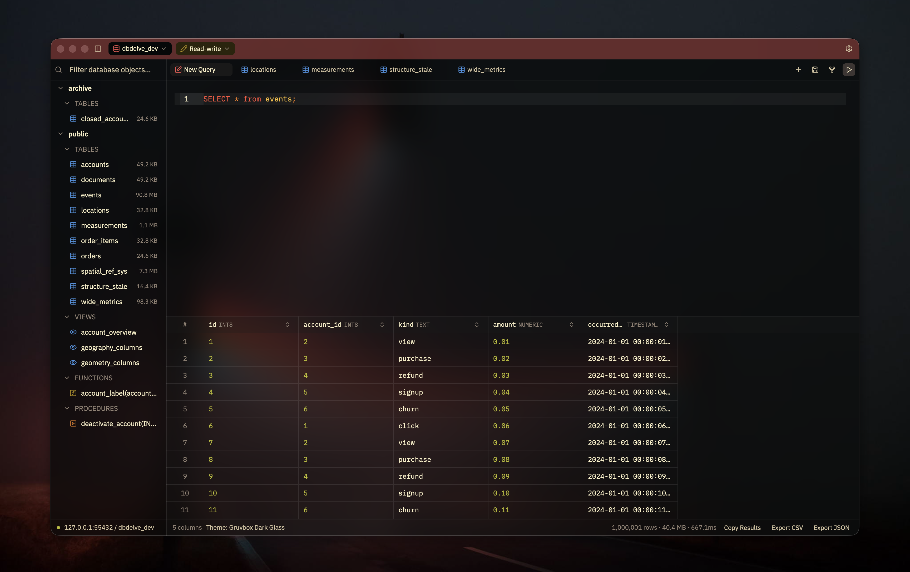
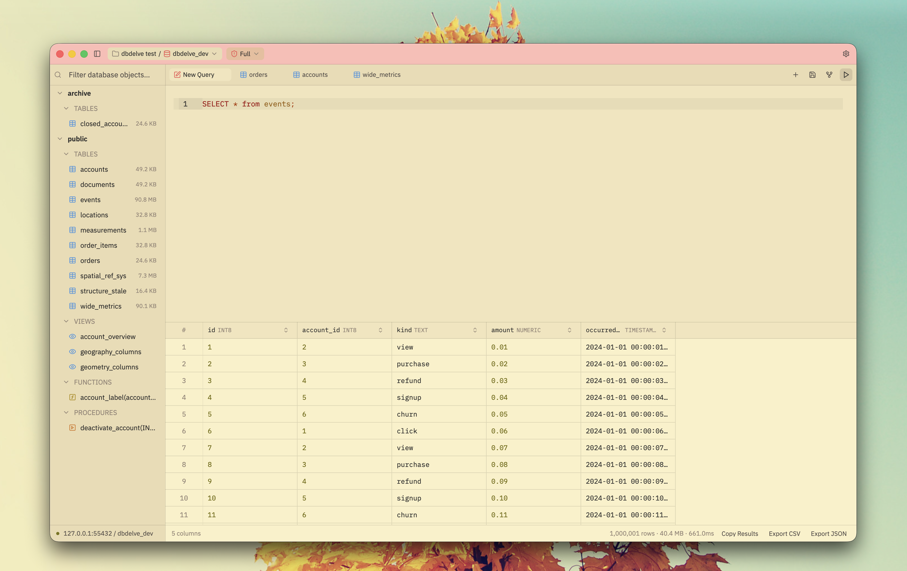

#  DBDelve

A fast, native, cross-platform, multi-engine database client. Written in Rust
with GPUI, with no Electron and no JVM, so it starts quickly, uses little memory
and keeps scrolling smoothly through large tables at which other clients crash or introduce limits.

> Early days. Everything listed below works today.





DBDelve in action with 1M rows loaded.

https://github.com/user-attachments/assets/ee555c10-4a18-4059-b451-bfadfc9f9ae0

## Why

I wanted something which is performant, modern and consumes little ram. The existing DB clients are either filled with bloat (Electron and JVM) or paid. This is an alternative to them. No feature is ever going behind a paywall and with time we will have complete parity on features with those too. 

## Benchmarks

DBDelve 0.3.6 against DBeaver 25.3.1 on the same Postgres table, median of 5
runs each (2026-10-11, M1 Pro, 32 GB):

| | DBDelve | DBeaver |
|---|---|---|
| Launch | 1.1 s | 5.2 s |
| Idle memory | 133 MB | 606 MB |
| 1,000-row query | 0.21 s | 1.96 s |
| 1M rows, time | 56 s | 208 s |
| 1M rows, memory\* | 4.9 GB | 17 GB |

\* Not a normal use case: this is the whole 1M-row table pulled into memory on
purpose, with the row limit turned off, and that result is itself 4 GB of data.
DBeaver needed its heap raised to 16 GB to finish it at all.

How these were measured, and the full results, are in [BENCHMARKS.md](BENCHMARKS.md).

## Supported databases

- **Postgres:** supported
- **MySQL:** supported
- **MariaDB:** supported
- **SQLite:** supported
- **Snowflake:** supported, without in-line editing since Snowflake doesn't
  enforce primary keys. See [docs/snowflake.md](docs/snowflake.md) for setup.
- **SQL Server:** supported, 2017 or later, without Explain. See
  [docs/mssql.md](docs/mssql.md) for what differs.
- **MongoDB:** supported, queried with mongosh statements like
  `db.accounts.find({ status: "active" })`. Browse, filter, sort, edit by `_id`,
  Explain and Format Query work as on the SQL engines. There are no
  transactions, so a batch of edits applies in order.
- **Redis:** supported (and Valkey, KeyDB, Dragonfly), with redis-cli commands
  in the editor. Browse a database's keys, open any key as a grid and edit
  strings, hashes, lists, sets and sorted sets in place. Read-only works by
  classifying every command. See [docs/redis.md](docs/redis.md).

Support for other database engines is planned, and more will be added over
time.

## What it does

- **Make it yours.** A theme library with DBDelve's own Dark, Light and Black,
  the first two also in translucent glass, alongside favorites like Catppuccin,
  Tokyo Night, Gruvbox and Dracula, each in dark and light, and each of those
  in glass. Import themes from Zed or VS Code, or write your own; see
  [docs/themes.md](docs/themes.md).
- **Bring your connections with you.** Import every saved connection,
  passwords and SSH settings included, from DBeaver on macOS, Linux and
  Windows, or from TablePlus on macOS.
- **Never mistake prod for staging.** Every connection keeps its own tabs,
  schema tree and history, and wears its own color in the title bar. Run it
  read-only, read-write or with full access, and DBDelve asks before anything
  destructive.
- **Edits you can read first.** Change a cell in place and DBDelve writes the
  `UPDATE` into the editor for you to check before it runs.
- **Keyboard-first.** A command palette for everything, fuzzy search across
  your schema, and every shortcut rebindable.
- **Your SSH, not a reimplementation.** Tunnels run through your own `ssh`, so
  your config, agent and hardware keys just work.

Free and open source, no telemetry, nothing behind a paywall.


## Installing

### macOS

Apple Silicon, macOS 12 or later — that's what it's built and tested on. Intel
and older macOS aren't blocked by anything in the code, they're just untested.

Homebrew is the recommended way. It handles installing and upgrading:

```sh
brew install --cask ShayanAbbas1/dbdelve/dbdelve
xattr -dr com.apple.quarantine /Applications/DBDelve.app
```

Don't skip the second line, or macOS will refuse to open the app. DBDelve is
signed ad-hoc: there's no Developer ID behind it and nothing is notarized, so
Gatekeeper declines until the quarantine flag is cleared.

Your connections and query history are kept outside the app and survive updates.
macOS will ask once more for the saved passwords in your Keychain after each
update, because each release carries a different ad-hoc signature. I'll
pay for a Developer ID if enough people end up using this, which removes all of
the above.

Failing Homebrew, take the `.dmg` from [the latest release][releases] and drag
DBDelve to Applications. Same quarantine step and you have to update manually.

To build it yourself instead, `DBDELVE_CHANNEL=release dev/bundle.sh` produces
`target/DBDelve.app` with the release build, icon and signature. Drag that to
Applications; the quarantine step doesn't apply here.

### Linux

Install from the AUR:
```sh
yay -S dbdelve-bin
```

It's maintained by
[@0PandaDEV](https://github.com/0PandaDEV), not by this project. Thanks for
packaging it!

A tarball or an AppImage, x86_64 or aarch64, built on Ubuntu 22.04 — that is
the oldest glibc either will run against, so anything at least that new is
fine. X11 and Wayland both work, and you need a Vulkan or OpenGL driver, a
Secret Service keyring (gnome-keyring or KWallet) for saved passwords, and
xdg-desktop-portal for the export dialog.

Take `dbdelve-<version>-linux-<arch>.tar.gz` from [the latest release][releases]
and run the `install.sh` inside it:

```sh
tar xzf dbdelve-*-linux-*.tar.gz
cd dbdelve-*-linux-*/
./install.sh
```

Everything goes under `~/.local`, so no root: the binary to `~/.local/bin`, the
icons and the desktop entry where your desktop looks for them, which is what
puts DBDelve in the app menu. Make sure `~/.local/bin` is on your PATH —
`install.sh` says so if it isn't. Updating means unpacking the next release and
running it again; `./install.sh --uninstall` reverses it and leaves your
connections and query history alone.

Or take `dbdelve-<version>-<arch>.AppImage` from the same release, which is one
file that runs where it lands:

```sh
chmod +x dbdelve-*.AppImage
./dbdelve-*.AppImage
```

It carries the libraries that are safe to carry and takes the graphics drivers
from your machine, so it runs on distributions either side of the one it was
built on. Running any AppImage needs FUSE 2, which Ubuntu 22.04 and later no
longer install — `sudo apt install libfuse2`, or `libfuse2t64` on 24.04 and
later, is usually the only thing missing. Failing that,
`./dbdelve-*.AppImage --appimage-extract` unpacks it and `squashfs-root/AppRun`
runs it with no FUSE at all.

What it does not do is put DBDelve in the app menu: an AppImage on its own is
just a file you run, so there is no desktop entry and no icon until you
integrate it — Gear Lever and AppImageLauncher both do that, or you copy the
entry out by hand. The tarball does it for you, which is still the reason to
prefer it. Updating either way is downloading the next one.

To build it yourself instead, on Debian or Ubuntu the build needs:

```sh
sudo apt install build-essential pkg-config cmake libfontconfig-dev \
  libxkbcommon-dev libxkbcommon-x11-dev libwayland-dev libdbus-1-dev
cargo build --release
```

The binary lands at `target/release/dbdelve` and runs from anywhere;
`dev/package-linux.sh` wraps that same build into the tarball above and
`dev/package-appimage.sh` into the AppImage. Connections and query history go
to `$XDG_DATA_HOME/dbdelve`, or `~/.local/share/dbdelve`.

Chords are the same as macOS with Ctrl in place of Cmd. A `profiles.toml`
carried over from a Mac keeps its `cmd-` overrides, which mean Super on Linux —
rebind them in Settings.

### Windows

A zip, x86_64, from [the latest release][releases]. Unzip it and run
`dbdelve.exe`. Nothing is installed. There is no installer.

To build it yourself instead, the build needs the MSVC toolchain and the
Windows SDK, which is what compiles the bundled SQLite and GPUI's shaders:

```sh
cargo build --release
```

The binary is `target\release\dbdelve.exe`. Connections and query history go
to `%APPDATA%\dbdelve`. Passwords go in Credential Manager. The window draws
its own title bar, buttons included. Chords are the same as macOS with Ctrl in
place of Cmd.

[releases]: https://github.com/ShayanAbbas1/dbdelve/releases/latest

For discussions and ideas join the DBDelve discord server: https://discord.gg/upKpusAnS

## Updating

`brew upgrade --cask dbdelve`, if you installed it that way. Otherwise the
status bar links to [the latest release][releases] once there is a newer one.

There is no telemetry. The only request DBDelve makes on its own is one to
GitHub at startup to check for updates, which you can turn off in Settings.

## License

Copyright (C) 2026 Shayan Abbas and contributors. Licensed under the
[GNU General Public License v3.0](LICENSE). See [NOTICES.md](NOTICES.md) for
third-party font and theme licenses.

Code contributed before the switch to GPL-3.0 was released under the
[MIT License](licenses/MIT-dbdelve.txt), and that notice still applies to it.
