#  DBDelve

A fast, native, cross-platform, multi-engine database client. Written in Rust
with GPUI, no Electron and no JVM: instant startup, friendly on your memory,
and smooth scrolling through large tables where other clients crash or
introduce limits.

> Early days. Everything listed below works today.

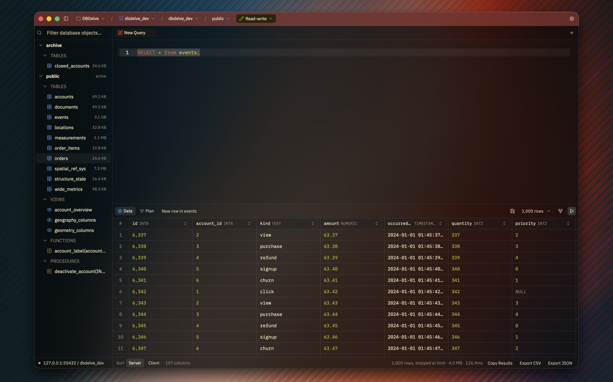

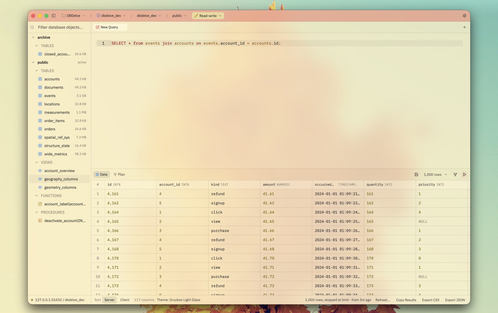

Scrolling a million rows:

https://github.com/user-attachments/assets/6e15d566-a110-46c6-a236-52af7d877d4c

Launching, with the last results already there:

https://github.com/user-attachments/assets/9e55da56-8577-43e0-812a-c77eb5d0e701

## Why

I wanted something which is performant, modern and consumes little ram. The existing DB clients are either filled with bloat (Electron and JVM) or paid. This is an alternative to them. No feature is ever going behind a paywall and with time we will have complete parity on features with those too.

## Install

**macOS** (Apple Silicon, macOS 12 or later):

```sh
brew install --cask ShayanAbbas1/dbdelve/dbdelve
xattr -dr com.apple.quarantine /Applications/DBDelve.app
```

Don't skip the second line: the app isn't notarized, so macOS won't open it
until the quarantine flag is cleared.

**Linux** (x86_64 or aarch64): `yay -S dbdelve-bin` from the AUR, or the
tarball or AppImage from [the latest release][releases].

**Windows** (x86_64): unzip the zip from [the latest release][releases] and run
`dbdelve.exe`.

Updating, the `.dmg`, Linux requirements, building from source and where your
data lives are all in [docs/install.md](docs/install.md).

[releases]: https://github.com/ShayanAbbas1/dbdelve/releases/latest

## Supported databases

Postgres, MySQL, MariaDB, SQLite, Turso, DuckDB, Snowflake, SQL Server, MongoDB,
Redis (and Valkey, KeyDB, Dragonfly) and ClickHouse.

More engines are planned.

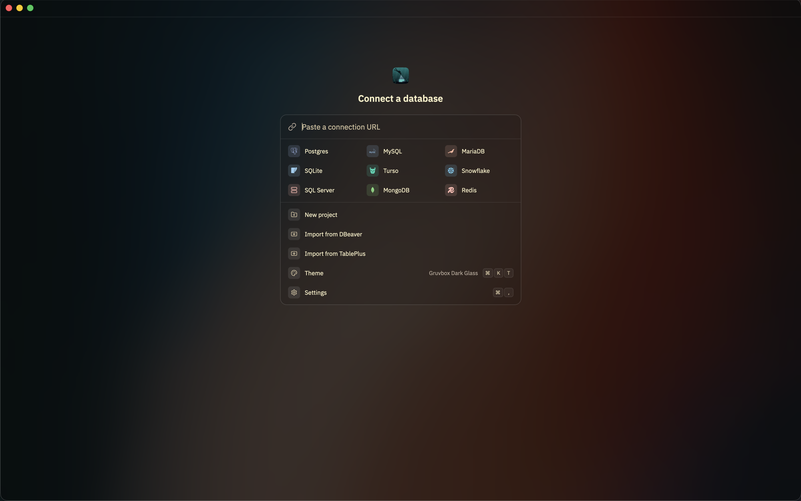

## What it does

- **Make it yours.** The app's own themes alongside Catppuccin, Tokyo Night,
  Gruvbox and Dracula, each in dark, light and glass. Import themes from Zed or
  VS Code, or [write your own](docs/themes.md).

  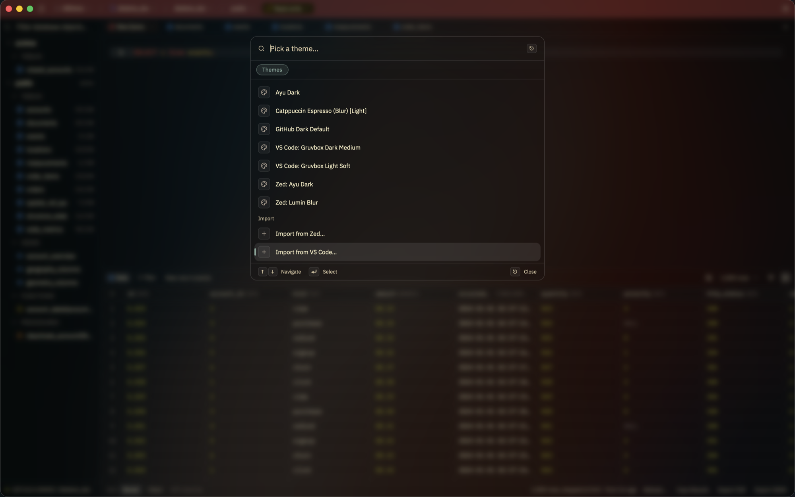

- **Bring your connections with you.** Import every saved connection,
  passwords and SSH settings included, from DBeaver, or TablePlus on macOS.
- **Organize your connections into projects,** and jump to any of them from
  the palette.

  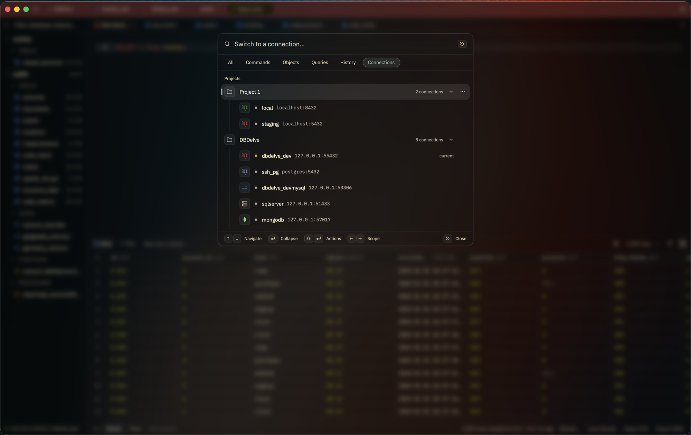

- **Never mistake prod for staging.** Every connection is isolated and can
  color the title bar. Run it read-only, read-write or with full access, and
  DBDelve asks before anything destructive.

  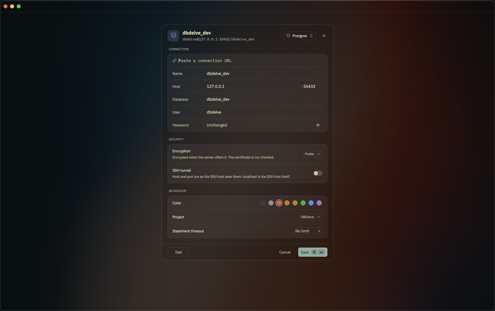

- **Edits you can read first.** Change a cell and DBDelve writes the `UPDATE`
  for you to check before it runs.
- **Keep the columns you need.** Hide or pin columns, and the layout survives
  a restart.
- **Read a row in full** in the row panel, with JSON highlighted, and edit long
  values there.

  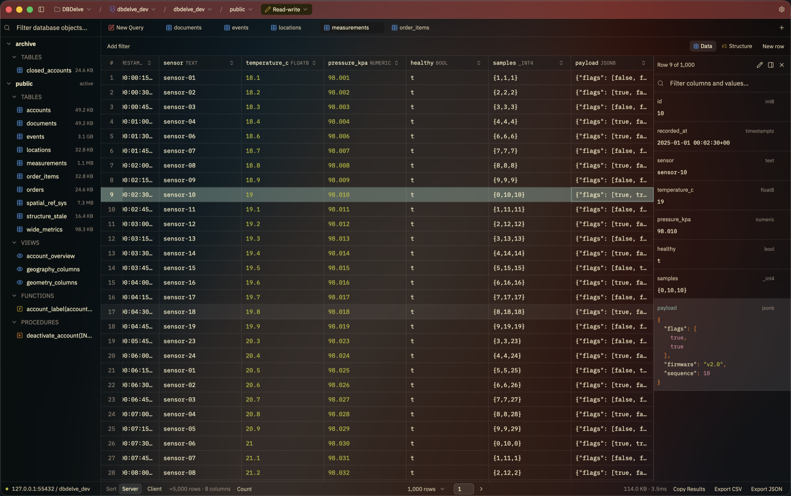

- **Import rows** from CSV, TSV or JSON, with every row checked and every
  statement shown before anything runs.

  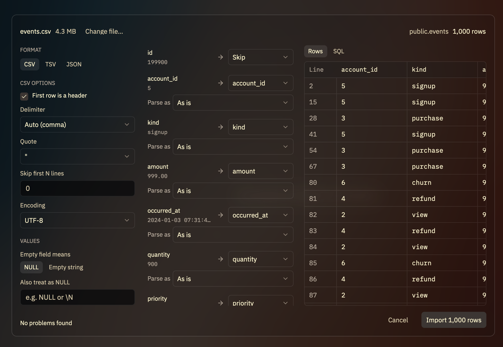

- **Open a data file** by dropping it on the window: a CSV, Excel, Parquet or
  JSON file opens in DuckDB, held in memory, as a query you can change.

- **See the query plan** highlighted in its own pane, with bad row estimates
  called out.

  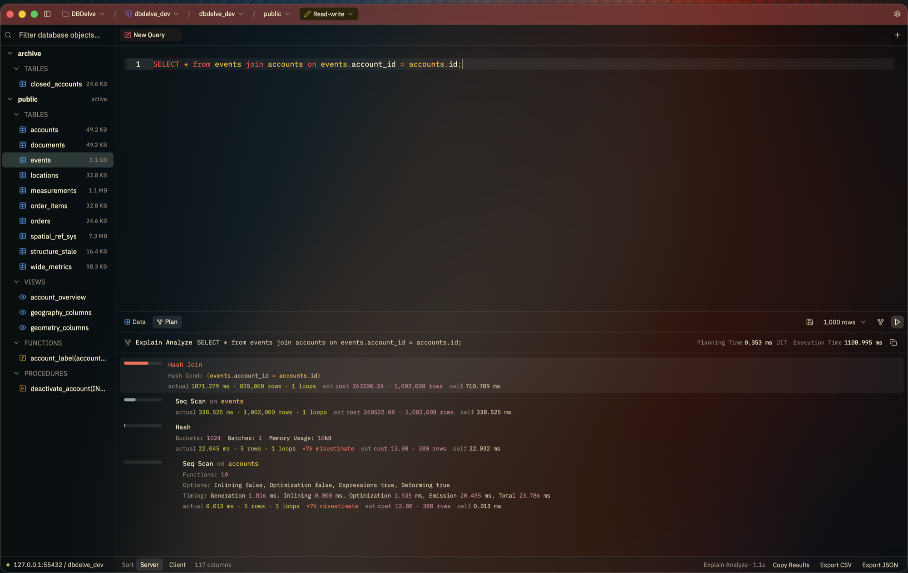

- **Completion that knows your schema:** tables, and a table's columns after
  its name and a dot.

  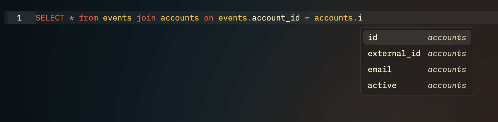

- **Keyboard-first.** One palette for commands, tables, saved queries, history
  and connections, and every shortcut rebindable.

  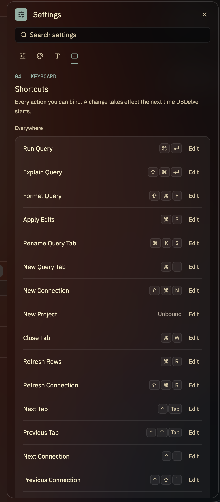

- **Your SSH, not a reimplementation.** Tunnels run through your own `ssh`, so
  your config, agent and hardware keys just work.

Free and open source, nothing behind a paywall, and no telemetry: the only
request DBDelve makes on its own is an update check, which you can turn off.

## Benchmarks

DBDelve 0.3.6 against DBeaver 25.3.1 on the same Postgres table, median of 5
runs each (2026-10-11, M1 Pro, 32 GB):

|                   | DBDelve | DBeaver |
| ----------------- | ------- | ------- |
| Launch            | 1.1 s   | 5.2 s   |
| Idle memory       | 133 MB  | 606 MB  |
| 1,000-row query   | 0.21 s  | 1.96 s  |
| 1M rows, time     | 56 s    | 208 s   |
| 1M rows, memory\* | 4.9 GB  | 17 GB   |

\* The whole 1M-row table pulled into memory on purpose, with the row limit
off. Method and full results in [BENCHMARKS.md](BENCHMARKS.md).

## Community

Ideas and discussion on [Discord](https://discord.gg/upKpusAnS).

## License

Copyright (C) 2026 Shayan Abbas and contributors, licensed under the
[GPL-3.0](LICENSE). Code contributed before the switch was released under the
[MIT License](licenses/MIT-dbdelve.txt), and that notice still applies to it.
Third-party font and theme licenses are in [NOTICES.md](NOTICES.md).
